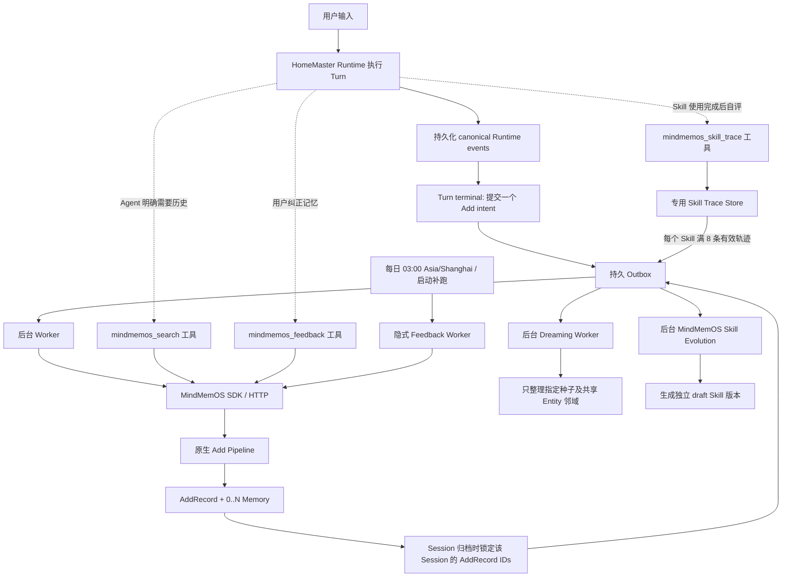

# V3.8 MindMemOS 原生生命周期集成规格

状态：供审阅，尚未实施

日期：2026-10-26

HomeMaster 基线：`main`，`e8d90f206c4ef2f1f8f52cb4758024c779c8733c`；审阅时工作区另有未提交修改 `src/homemaster/memory/mindmemos_runtime.py` 与 `tests/homemaster/memory/test_mindmemos_runtime.py`，均未修改且不属于本规格。

MindMemOS 基线：`/Users/wylam/Documents/workspace/MindMemOS`，`186db4a75122b1d8691933f280bec10191c82c28`（审计时本地 `main` 与 `origin/main` 一致，工作区干净）

## 1. 目标

让 HomeMaster 以指定最新版 MindMemOS 的原生 Add、Search、Feedback、Dreaming 和 Skill Evolution 为记忆引擎，并由 HomeMaster 明确管理这些能力的触发时机。目标生命周期从 MindMemOS 能力与已确认的产品决策推导，不继承现有 HomeMaster Finalizer、队列阈值或自动召回的时机。HomeMaster 的 Runtime、Session、权限和工具执行轨迹继续提供真实事件与调用边界；它不再拥有另一套 Session 结束提取流水线。

本规格锁定已讨论的行为：第一版每个已终结 Turn 使用 MindMemOS Vanilla Add 提交一次 Add；Turn 后 Add 在后台完成；Agent 按需调用 Search；显式 Feedback 是 Agent 工具；隐式 Feedback 每日调度；Dreaming 在 Session 归档后按该 Session 的 Add 种子运行；Skill 轨迹有专属入口，累计 8 条有效轨迹后后台触发进化。`03:00 Asia/Shanghai` 是为规格落地暂设的调度默认值，尚未由用户最终锁定。

本文件只定义目标与验收标准，不执行源码替换、数据迁移、服务调用或生产记忆写入。

### HomeMaster 当前状态基线

以下是现有代码事实，不是目标行为：

- `SessionFinalizer.finalize()` 在 Session 结束后收集事件、构造 `homemaster.schema_episode.v1`，然后串行运行 Schema Add、隐式 Feedback 和 Dreaming 协调器；入口由 `SessionFinalizationController.enqueue()` 提交到当前进程内的 `MemoryAddQueue`。相关实现位于 `src/homemaster/experience/finalizer.py`、`src/homemaster/experience/session_finalization.py` 和 `src/homemaster/application/composition/base.py`。
- HomeMaster 当前 `AutomaticRecallService.recall()` 在 Provider 执行前进行 Search；`SessionRuntime.consume_recall()` 也控制召回 latch。V3.8 删除这条自动路径，保留 Agent 按需调用的 Search 工具。
- `build_memory_tools(mode="full")` 仍向 Agent 注册 `mindmemos_add`、Search、Feedback 和管理工具。V3.8 从 Agent 注册表移除普通 Add 工具，Add 只由 Turn 后台 Worker 调用。
- Web Memory 页面已有记忆列表、详情/历史、手动创建、编辑和删除界面，但当前创建走 `EmbeddedMindMemOS.add_flat()`，编辑只开放给 plain 记忆，结构化记忆不能在页面改正；更新异常时还有“flat 新增 + 删除旧记录”的 HomeMaster fallback。V3.8 必须把页面和后端管理 API 一并迁到新版 MindMemOS 原生管理合同，并补齐所有可见活动记忆的人工更正路径。
- Web `/archive`、CLI `/archive`、CLI `/new` 和退出都会进入当前 Session end handler；当前 `/archive` 会话仍可继续写入，控制器没有不可变的归档边界 ID。V3.8 定义新的 Archive Snapshot 合同，不复用当前 Finalizer job 身份。
- 当前 `JsonlTraceSink` 将 Runtime events 写到 application run directory；该路径本身不构成跨进程、跨重启的 per-Session canonical trace 保证。V3.8 必须提供持久、可恢复、按 Session 有序的事件记录，作为 Add、Archive 和 Skill Trace 的唯一轨迹来源。

MindMemOS 当前源码也有必须先补齐的接口缺口：`DialogueMessage` 接受标准 `tool` role，但 Vanilla `TurnGrouper.group()` 没有保留它的处理分支；Add 没有调用方幂等 ID 与结果对账合同；Dreaming 输入没有 seed AddRecord IDs；Skill Evolver 虽已有 `skill_trace_pending_v1` / `skill_trace_summary_v1` 中间存储，候选源仍是普通 AddRecord `skill_bindings`，没有以专用 Skill invocation trace 为唯一候选来源的写入/claim 合同。这些是上游新版实现任务，不得由 HomeMaster 兼容分支绕过。

## 2. 术语与基础事实

**Turn Add** 是一次 MindMemOS Add 请求，对应一条 Add 活动记录（AddRecord）。MindMemOS 的一次 Add 可能生成零条、一条或多条 Memory。Dreaming 的“种子”是成功 Add 的 AddRecord 及其产出的 Memory ID 集合，不能假定每个 Turn 恰好生成一条 Memory。

因此，含 10 个已终结 Turn 的 Session 会提交 10 个 Turn Add；重试不得创建额外 AddRecord。Dreaming 以这 10 个 AddRecord 为本 Session 的种子输入，再按这些记录产出的 Memory 和共享 Entity 建立整理范围。没有产出 Memory 的 AddRecord 仍是活动记录，但不会伪装成可整理的 Memory 种子。

“无自动 Pre-turn Search”只表示不在 Agent 开始推理前自动调用 Search API 或注入搜索结果。它不关闭 MindMemOS Vanilla Add 自身的 related-memory recall 阶段；该 recall 是 Add Pipeline 的内部提取上下文，发生在 Turn 后后台 Add 中，不把延迟加到当前 Agent 响应上。

本规格锁定的 MindMemOS 上游基线 `186db4a75122b1d8691933f280bec10191c82c28` 具备如下边界（源码路径相对 MindMemOS 仓库）：`DialogueMessage` 接受 `tool` role（`src/mindmemos/mindmemos/typing/memory.py`），但 Vanilla `TurnGrouper.group()` 当前只把 `user`、`assistant`、`system` 加入 Turn，标准 `tool` 消息会被忽略（`src/mindmemos/mindmemos/components/chunker/vanilla/turn_grouper.py`）。`DreamingPipelineInput` 当前只有 `mode`，没有种子参数（`src/mindmemos/mindmemos/typing/service.py`）。Add 服务自行生成 AddRecord ID，但 Add API/SDK 的结果只暴露 request ID 和生成的 memories，没有调用方操作 ID 或 AddRecord ID（`src/mindmemos/mindmemos/api/services/memory_service.py`、`src/mindmemos_sdk/mindmemos_sdk/memory/models.py`）。Add 因而尚无本规格要求的请求级幂等合同。

原生隐式 Feedback 的输入不是 `session_id`，也不是调用方枚举的一组种子。调用方省略 `FeedbackPipelineInput.feedback` 后，`ImplicitFeedbackHandler` 通过 `RecentActivityCollector` 读取近期 Add/Search 活动，按 Session 汇集 Add 对话轮次、Add 产生的 Memory 和 Search 召回的 Memory，再检测轮次中的隐式纠错并规划记忆 action（`src/mindmemos/mindmemos/pipelines/feedback/implicit.py`）。显式 Feedback 则提供具体 `feedback` 文本、完整相关对话和本轮实际召回的 memories（`src/mindmemos/mindmemos/typing/service.py`、`src/mindmemos/mindmemos/api/schemas.py`）。当前 Skill Evolver 的候选来源为 AddRecord payload 中的 `skill_bindings`（`src/mindmemos/mindmemos/pipelines/skill/evolution.py`）；V3.8 要改为本规格定义的专用轨迹 Store。

**HTTP API** 是 MindMemOS Server 的公开协议和身份/算法映射边界。**Python SDK** 是对 HTTP 请求、序列化、响应解析和错误的类型化封装，本身不执行另一个记忆算法。SDK 的 `async` 方法表示异步 I/O；请求中的 `mode="async"` 表示把业务工作交给 Kafka Worker，两者含义不同。MindMemOS 当前异步业务模式依赖 Kafka，`queued` 也不代表记忆已经完成写入。

Agent 不直接调用 HTTP，也不暴露 MindMemOS API Key。HomeMaster 工具才是 Agent 的工具协议；HomeMaster Executor 将受权限检查的工具输入映射到 MindMemOS SDK/API。Agent 看见的 `mindmemos_search` 等是 HomeMaster 工具，不是 MindMemOS HTTP 路由名。

### 3.1 第一版 Add 算法决策：原生 Vanilla Add

第一版采用 MindMemOS `vanilla` memory algorithm（服务端映射到 `vanilla_add` pipeline）处理每个已终结 Turn，判断为合理并锁定。它接收真实对话和工具事件，原生执行分块、相关记忆召回、抽取、去重/强化/更新/合并和向量化；它不是 HomeMaster 把整段轨迹直接写成一条平铺文本。一次 Add 请求对应一个 AddRecord，输出允许为零条或多条 Memory，因此“每轮 Add”承诺的是每轮都有可对账的原生 Add 活动，不承诺每轮恰好生成一条记忆。

| 第一版做法 | 代价/边界 | 决策 |
|---|---|---|
| MindMemOS Vanilla Add | 依赖新版原生抽取/去重行为；必须确认输入分块及工具调用/结果不会丢失。实体抽取默认关闭，若不显式启用会削弱按共享实体运行的归档 Dreaming。 | **采用**；每 Turn 由后台 Worker 调用，设置 `memory_algorithm=vanilla`，并在 MindMemOS 服务部署配置中显式启用 `algo_config.add.vanilla.enable_entities=true`。 |
| MindMemOS Schema Add | 强制固定 schema 会重新引入领域 extractor 与本项目暂不需要的类型约束，且不符合本轮按原生一般对话记忆生命周期工作的决定。 | 第一版不采用；删除 HomeMaster V3.6 Session Finalizer 的 Schema Add 路径。 |
| HomeMaster/服务端直接平铺写入 | 简单确定，但绕过 Vanilla 提取、与已有记忆对齐及原生 AddRecord 语义，可能重新制造两套记忆逻辑。 | 不能作为 Turn Add fallback；人工管理创建需单独使用 MindMemOS 原生管理写入合同。 |

Vanilla Add 的 related-memory recall 是 Add Pipeline 为抽取提供的内部上下文，不等同于 Agent 的 Pre-turn Search。用户暂不启用 Agent Pre-turn Search，不影响每轮后台 Vanilla Add。HomeMaster Outbox 只负责持久入队、重试与恢复；worker 可在后台等待同步 MindMemOS 请求的终态，Agent 执行进程不得等待该请求。MindMemOS HTTP 身份映射必须固定为 `vanilla`，不能让某个部署 API key 意外落到 Schema Add。

MindMemOS 当前 `enable_entities` 默认 `false`。V3.8 的实际配置与外部验收必须证明 Vanilla Add 为成功记忆写入建立需要的 Entity/MENTIONS 关系；不能只检查配置值或 Add 返回成功。如果实体抽取或图写入失败，Add 可以按原生合同报告部分/失败状态，但该实例不能通过 Dreaming 依赖门。

## 3. 集成方式决策

评估过三种接入方式：

| 方式 | 代价 | 结论 |
|---|---|---|
| 在 HomeMaster 内直接构造 Pipeline | 少一个服务，但调用方需复制 Service 的身份映射、AddRecord、Skill 绑定和错误合同；容易再造一套 MindMemOS 生命周期 | 不作为目标入口 |
| Agent 进程直接调用 MindMemOS 的 Kafka async API | 使用公开业务 API，但增加 Kafka 依赖；Agent 仍要处理排队确认、完成跟踪和 Kafka 持久确认差异 | 不作为第一阶段的任务调度方案 |
| HomeMaster 工具/Runtime + 持久后台 Outbox + MindMemOS SDK/HTTP Server | Agent 只等待本地任务意图持久化；独立 Worker 调用公开 MindMemOS API 的同步模式并核对终态；不要求 Kafka 才能满足 Agent 非阻塞 | **推荐** |

第三种方式意味着 MindMemOS Server 作为独立服务运行；Python SDK 负责调用其 HTTP API。它是本规格的推荐接入方式，仍需在实施前确认部署拓扑和服务运维归属。若选择进程内集成，必须调用新版公开 Service/契约层并补齐等价幂等、恢复和状态查询能力，不能绕过这些合同直接拼 Pipeline。

V3.8 采用第三种方式。Agent 使用 HomeMaster 工具协议；HomeMaster 执行器把工具输入映射到 MindMemOS SDK 方法，SDK 再按 HTTP Server 协议发送请求。换言之，“HTTP 映射”是 HomeMaster 把 Agent 的语义化工具参数转换为 MindMemOS API 请求，并不是把 API 路由直接暴露给 Agent。`mode="sync"` 在后台 Worker 内等待 MindMemOS 完成，不会阻塞 Agent 的 Turn；HomeMaster 的 Outbox 负责 Agent 生命周期之外的排队、重试、崩溃恢复和状态查询。这不把 Python `async` 冒充业务异步，也不把 `queued` 冒充完成。

MindMemOS HTTP Server 可以部署在本机或远端。端点和凭据从受忽略的部署配置/环境变量读取，不硬编码 `localhost`；两种部署都使用相同 SDK 契约。多进程/多主机运行时，任务 Store 必须由所有相关 Worker 通过抽象接口访问；单机默认实现可使用持久 SQLite Outbox。

## 4. 生命周期



### 4.1 每个 Turn 的 Add

1. Runtime 将该 Turn 的 canonical 用户消息、助手消息、工具调用和工具结果写入持久 per-Session Runtime Trace，并形成稳定的 `turn_id`、`session_id`、单调递增的 `event_seq` 和规范化 terminal 状态。现有 run-directory trace 不足以保证跨进程恢复，必须由新的 Session Trace Store 或等价持久实现提供这一合同。Turn 指一次用户输入至该次 Agent 响应结束的完整执行，包括该次响应中的全部工具调用/结果；Provider 内部重试不是新 Turn。
2. 每个进入 terminal 状态且有可持久化事件的 Turn 都产生一个 Add intent，包括成功、部分完成、失败或用户取消的 Turn。规范化 terminal 状态来源于唯一的权威 `RunResult` / Runtime lifecycle commit，不依赖某一种原始事件必定存在：正常结束映射 `runtime.turn_completed`，失败映射 `runtime.turn_failed`，预算耗尽映射 `runtime.budget_exhausted`，取消映射 `runtime.cancelled`；当前实现中只有 `runtime.guard_triggered` 的失败路径也必须由其 failed `RunResult` 形成 terminal 记录。Trace Store 对 `(session_id, turn_id)` 只接受一个 terminal commit；实现需覆盖每条 Runtime 返回、异常和取消路径。进程在 Turn 中途崩溃时，先由持久运行所有权/恢复逻辑判定其为仍活动或已中断；只有被权威终结为 interrupted 的 Turn 才补建 intent，不得凭空造空 Turn 或把活动 Turn 提前 Add。
3. Add 输入由真实、有序的 Turn 对话及工具事件构成，保留工具调用与结果的对应关系、调用状态和时间。只传入 Agent 对话上下文中的用户/助手可见消息和真实工具调用/结果；内部思维内容、传输层 delta、重复 final、内部权限对象、凭据和二进制载荷不作为消息；文件/媒体用已授予权限的稳定引用。
4. MindMemOS 当前 `DialogueMessage` 可表示常见对话和 `tool` 角色，但 Vanilla `TurnGrouper` 当前没有保留标准 `tool` 角色的分支。最新版集成必须补齐原生 Add 对 tool-call/result 的保留与配对。由于公开 DialogueMessage 目前只有 role/content/timestamp，HomeMaster 将每次调用和结果按 `tool_call_id` 分别规范化为可重放的 JSON 文本：调用作为 `assistant` 消息、结果作为独立 `tool` 消息；MindMemOS 必须在 vanilla 分组、切块和提取输入中保留双方及其顺序。不得把工具结果静默丢弃，也不得把旧 HomeMaster 三路 Schema extractor 留作 fallback。Skill Trace 也从这份 canonical Trace 派生，但按专属 Skill invocation 边界单独截取。
5. Agent 只等待 Outbox 将稳定 intent 持久化并返回 `accepted`。不得等待 MindMemOS HTTP、LLM、embedding、Qdrant 或 Neo4j；也不得把 `accepted` 显示为“记忆已写入”。
6. Worker 以稳定操作 ID 调用 MindMemOS 原生 Add 的同步业务接口，直至收到终态。Add 成功后记录真实 `add_record_id`、MindMemOS 返回码、全部生成的 `memory_id` 和逐项 raw readback 结果。
7. HTTP 超时而结果未知时先按同一操作 ID 对账，不能新建第二条 Add。MindMemOS 必须先持久化 operation reservation，再开始提取；需持久化可恢复的 Add 处理状态和写入身份，使服务端进程在提取中/写入中崩溃后能对同一 AddRecord 恢复，不能重新提取并生成另一套 Memory ID。明确失败的任务保留失败状态和输入摘要，可重试；不得覆盖原始 trace。

Add 输入最小身份与幂等字段：

```json
{
  "operation_id": "<stable-id-from-session-and-turn>",
  "turn_id": "turn-12",
  "session_id": "session-7",
  "user_id": "<HomeMaster actor mapping>",
  "messages": [
    {"role": "user", "content": "把客厅灯打开"},
    {"role": "assistant", "content": "{\"tool_call_id\":\"call-1\",\"name\":\"device.read\",\"arguments\":{\"device\":\"living_room_light\"}}"},
    {"role": "tool", "content": "{\"tool_call_id\":\"call-1\",\"result\":{\"is_on\":false},\"status\":\"success\"}"},
    {"role": "assistant", "content": "客厅灯已经打开。"}
  ],
  "metadata": {"source": "homemaster.turn", "turn_outcome": "success"}
}
```

该示例说明最小语义，不规定敏感数据或二进制内容格式。`operation_id` 在同一 MindMemOS project/actor scope 内唯一，并由服务端与 `payload_hash` 一起持久化。相同 ID、相同 hash 的重放必须返回既有 AddRecord 和原任务状态，不得再跑提取或创建新记录；相同 ID、不同 hash 必须以冲突错误拒绝。服务端提供按 operation ID 查询/对账的公开 API；同步 Add 的终态回执包含 `operation_id`、`add_record_id`、业务状态及全部实际 Memory ID。该幂等字段必须成为 Add API、SDK、AddRecord 持久层及读取/对账接口的一等合同，不能只塞入普通 metadata 后假定服务端已实现幂等。

### 4.2 Search

- V3.8 不执行自动 Pre-turn Search，也不在 Provider 前等待记忆检索。
- Agent 自主 Search 与 Vanilla Add 内部 related-memory recall 是两条不同路径：前者由 `mindmemos_search` 工具触发并返回给 Agent；后者由 MindMemOS Add Pipeline 为提取阶段召回相关记忆。V3.8 暂缓测量和启用 Agent Pre-turn Search，不要求关闭 Add 内部 recall。
- Agent 根据当前任务需要调用 `mindmemos_search`。HomeMaster 将 query、limit/type/filter 映射为 SDK 的 Search 参数，显式传入当前 HomeMaster actor 的 user/app/agent 范围，并消费原生结果。
- Search 的结果作为本次工具结果加入 Agent 当前上下文；不写入历史 Session，不自动把同一结果反复注入后续 Provider 请求。
- Search 成功与否由 MindMemOS response code、实际返回记录和准确 raw memory ID 判断。搜索空结果是有效空结果；服务错误不得伪装为空结果。
- 用户后续显式纠正时，Feedback 只信任成功 Provider attempt 中实际可见的自动上下文和 Search raw IDs，并在执行前重读验证 scope、active 状态和正文。

### 4.3 显式 Feedback

`mindmemos_feedback` 保留为 Agent 可自主调用的工具。典型触发是用户指出“我说的是现在住苏州，以前住杭州”，或明确要求纠正/忘记错误的长期记忆。普通任务失败、工具返回错误或 Agent 对自己不满意，本身不构成用户记忆纠错信号。

HomeMaster 将 Agent 提交的具体纠正文本、准确 provider 对话轮次和该轮真实可见的候选 Memory 传给 MindMemOS 显式 Feedback。候选 ID 必须先由 HomeMaster按 actor scope 读取并验证。显式工具调用等待原生 Feedback 终态并返回每个 add/update/delete/noop action 的结果；某项写操作未通过 raw DB 终态核验时，整体工具不得声称成功。

显式 Feedback 的重试使用稳定 `feedback_operation_id` 和 action 身份。MindMemOS 必须能在 action 部分成功或 HTTP 响应丢失后对账并续跑，不能重复创建同一纠正所对应的新增 Memory，也不能再次覆盖已完成的版本更新。

### 4.4 隐式 Feedback

- 隐式 Feedback 作为独立、持久、每日任务运行，默认每天 `03:00 Asia/Shanghai`。HomeMaster 启动时检查持久 watermark；若上次成功窗口已到期，补跑一次漏掉的窗口。相同 scope/window 使用稳定 job ID，不因重复启动重复执行。
- 输入是 MindMemOS 最近的 Add/Search 活动记录：Add 中带角色的真实对话轮次、Add 所产出的 Memory、Search 查询与真实召回 ID。不得把整份 Episode JSON 包装成一条 `TextMessage`，也不得把 tool failure 推断为 Memory 错误。
- HomeMaster 每个调度窗口调用原生隐式 Feedback 流程，不自行复制 `RecentActivityCollector`、信号检测或 action 规划。原生接口的业务输入是省略 `feedback` 的 Feedback 请求；任务窗口、scope、输入活动快照/ID 和 checkpoint 要作为可恢复的 job 元数据传给新增的调度封装。MindMemOS 当前 collector 默认读取最近 3 天的活动，因此上游扩展必须让调度窗口与已处理标记/游标一致，不能把同一活动无限重放，也不能因活动超过 lookback 就漏处理。
- 目标是从活动中识别用户纠正、被指出的偏好/事实错误、明确范围变化或长期指令，找到相关 Memory 后规划 add/update/delete/noop。重复 Search 或不同说法是检索诊断线索，不单独授权修改记忆。
- MindMemOS 的隐式 Feedback 与 Dreaming 都可读取近期 Add 活动，但职责和调度不得合并：Feedback 只针对纠错信号治理记忆；Dreaming 在归档事件后针对指定 Session 种子按实体关系整合记忆。两个任务都必须保留并能独立观测/重试。
- 仅在分析和全部 action 的结果可核验后推进对应活动记录的处理 watermark。HTTP/LLM/DB 失败不能被记成已处理；重试须幂等并先核对已成功的部分 action。
- 当前原生实现会在每个 session material 的 action 执行器返回后标记 AddRecord `feedback_processed`，但它没有在这里强制检查所有 action 的外部终态。本规格要求新版 handler 改为逐 action 可恢复 checkpoint：仅在分析结果持久化、全部 action 可核验后推进对应活动记录的处理 watermark。

### 4.5 Session 归档后的 Dreaming

归档是独立于旧 HomeMaster Finalizer 的持久 Archive Snapshot，不要求 Runtime Session 本身变为只读，也不以 Finalizer job 状态作为归档身份。V3.8 的 Session owner 在 Session 正式完成/关闭时请求归档；这包括用户主动归档、用户切换到新 Session（如 `/new`）以及正常关闭时显式结束活动 Session。Turn 完成但 Session 仍开放时不归档；进程崩溃不伪装成正常关闭，由恢复流程处理遗留状态。新生命周期必须在上述 Session 边界直接提交 Archive Snapshot 请求，不依赖旧 Finalizer callback。每个 Snapshot 原子锁定一个未归档 Turn 区间及其最大 `event_seq`，并持久分配稳定 `archive_id`。相同边界的重复请求返回同一个 `archive_id` 并幂等；会话在归档后继续产生新 Turn 时，后续归档生成新的 Snapshot，只覆盖上次边界之后尚未归档的 Turn。Archive 接受/入队不得等待 Dreaming 完成。现有 `DELETE /api/sessions/{session_id}` 是本地 Session 管理接口，会移除本地会话文件、运行时对象和上传附件；它不删除已写入 MindMemOS 的长期记忆，也不负责触发 Archive/Dreaming。Session 删除行为不属于 V3.8 记忆生命周期重构范围，保持现状，不新增软删除、级联清理或专门验收。

归档时持久锁定该 Snapshot Turn 区间内的全部 Turn Add 操作 ID。后台等这些 Add intent 获得确定终态后，只把成功且能读回的 AddRecord ID 传入 Dreaming；Add 状态未知时先对账。明确失败或无记忆结果的 Add 不伪装成种子。Dreaming 输入必须包含精确 `session_id`、`archive_id`、scope 和 `seed_add_record_ids`，不能退回到“最近 N 天/最近 N 条记录”的全局候选。分段 Snapshot 的边界外 AddRecord 永远不能进入当前 batch。

MindMemOS 当前公开 `DreamingPipelineInput` 只有执行模式，没有 seed IDs。V3.8 必须在锁定的上游基线上扩展原生 Pipeline、API schema/mapper、SDK 与 worker，使 `archive_id` 和 `seed_add_record_ids` 贯穿到 Dreaming 候选收集；旧 HomeMaster vendor 中可能存在相似的种子补丁，只可依据新版接口重新实现并审阅，不得把旧 vendor 分支整体拷回。Dreaming 从指定 AddRecord 取其 Memory IDs，定位这些 Memory 提及的 Entity，并以每个被种子 Memory 提及的 Entity 分别建立整理范围；若多个种子 Memory 提及同一 Entity，该 Entity 只建立一个范围。范围内可以读取相同 actor scope 下已有的邻接 Memory，以便判断新旧事实关系，但只有 `seed_add_record_ids` 所列 AddRecord 可作为本批次种子或被标记为本批已消费；其他 AddRecord 不得因为相同 Entity 被误标为本批已完成。无 Memory、无种子 Entity 或无可执行 action 应返回真实 `no_action`，不得借机整理其他 Session 的未归档记录。

每个归档的 `archive_id` 同时作为 Dreaming job 的稳定操作身份。MindMemOS action 应有稳定 action ID；重试须先读回每个已执行 action 并跳过已完成项，避免 merge/archive/link 在部分失败后重复执行。对同一 actor/entity 可能重叠的 Dreaming batch 必须串行处理或使用等价的并发冲突合同，防止不同 Snapshot 同时基于过期邻接状态写入相互冲突的结果。

每个 batch 单独持久化提交/处理中/完成/无操作/失败状态。结果须返回 seed 覆盖、处理的实体 scope 和实际 action；MindMemOS Worker 以每个目标的 Qdrant raw memory 与 Neo4j 状态/关系读回作为完成门。新 Session/其他 Session 的 Add 不得进入被锁定 batch；失败 batch 可原样重试。

### 4.6 Skill 轨迹与自进化

Skill 轨迹使用单独的 `mindmemos_skill_trace` Agent 工具和 MindMemOS 专用数据接口，不是普通 Memory Add，也不从用户对话或通用 AddRecord 推断 Skill 使用。

当 HomeMaster 实际加载一个已登记到 MindMemOS Skill Version Store 的 Skill 时，为该次 invocation 打开一个 `invocation_id`。该身份必须绑定 HomeMaster 本地 skill registry ID、MindMemOS `cloud_skill_id`、当次实际加载的 `version_id`、精确 `SKILL.md` hash 和起始 Turn。MindMemOS SDK 已有 `SkillManager` 的 register/history/sync 能力，但 HomeMaster 当前 `SkillDefinition` 并不带云端版本身份；实施时必须通过显式注册映射关联两者。未登记或 hash 与登记版本不一致的 Skill 不得猜测版本，也不得进入 Skill Evolution。

Skill 执行结束后，Agent 通过专用工具提交 `invocation_id`、结果类型和自评分以封存轨迹；HomeMaster 在实际向 Agent 上下文加载/启用已登记 Skill 时创建 invocation，并将其 ID 暴露给 Agent 供封存使用。Runtime 将实际归属于该 invocation 的工具调用/结果与 `invocation_id` 一起持久记录；封存时 HomeMaster 只读取这一组已关联事件，不接受 Agent 手写或补造工具步骤。归属由运行时 Skill 执行上下文建立，不能靠全文搜索推测或把同一工具调用复制到多个轨迹。轨迹只覆盖一次 invocation；同一 Skill 跨 Turn 再次使用就单独落一条，不拼接、平均或合并；封存工具调用本身不记入被评价的 Skill 工具步骤。没有完成封存工具调用的中断 invocation 不进入进化候选。

最小轨迹内容：

```json
{
  "invocation_id": "skill-invocation-3",
  "skill_id": "<HomeMaster-local-skill-registry-id>",
  "cloud_skill_id": "<MindMemOS-skill-id>",
  "skill_version_id": "<exact-loaded-version>",
  "skill_content_hash": "<sha256>",
  "turn_id": "turn-12",
  "task_input": "把客厅灯恢复到上次的夜间设置",
  "agent_completion": "客厅灯已设为夜间亮度 20%。",
  "outcome": "success",
  "score": 0.82,
  "tool_steps": [
    {
      "tool_call_id": "call-8",
      "invocation_id": "skill-invocation-3",
      "tool_name": "file.read",
      "arguments": {"device": "living_room_light"},
      "tool_result_tail": "<超过 500 字符时保留的最后 500 字符>",
      "tool_result_truncated": true,
      "status": "success"
    }
  ]
}
```

`task_input` 只记录本次 Skill invocation 实际承担的任务指令；`agent_completion` 记录封存时 Agent 对用户可见的结果，不保存隐藏推理。每个 `tool_result` 先转成确定性文本，再按 Unicode code point 从结果末尾保留最多 500 个；长于 500 个时仅丢弃前缀并设 `tool_result_truncated=true`。不能存完整超长结果再只在模型提示中截断。轨迹按 invocation 一条记录持久化，成功和失败轨迹都保留，不做均分或合并；只保存理解这一次执行所需的 skill/version 身份、Turn 关联、任务结果、自评分和 invocation 边界内真实工具步骤，不附加整份 Turn 或 Session、无关 Runtime 事件。最终轨迹存储在 MindMemOS 专用 Skill Invocation Trace Store，写入与回执需可按稳定 `invocation_id` 幂等重试、读取和消费；不得复用 AddRecord，也不得双写到普通 Add 活动。

工具参数按原始结构保存，但必须先按现有凭据/敏感值规则脱敏。工具结果若为结构化值，先用确定性紧凑 JSON 序列化，再按 Unicode code point 取末尾 500 个。每条 trace 限定到一个 Turn；跨 Turn 再次使用同一 Skill 时创建全新 invocation 和独立轨迹，不做跨 Turn 聚合。`invocation_id` 是 Skill Trace 写入/读取/封存身份；它只作为 Runtime 工具事件的关联字段，不向工具目标或其他外部服务透传。轨迹之外不额外保存重复的 AddRecord/Session 副本。

Agent 自评范围为 `0..1`，`outcome` 单独记录为 `success` 或 `failure`：成功的 score 为 `0.5..1`，失败为 `0..0.5`。边界 `0.5` 可用于任一明确 outcome，不能只用数值倒推 outcome。成功和失败轨迹均可进入自进化批次。

HomeMaster 在一条有效轨迹成功写入后检查该 skill 的未消费轨迹数：少于 8 条不触发；达到 8 条时自动为同一 Skill 创建持久后台 Evolution job，Agent Turn 不等待进化。每批恰好 claim 8 条有效轨迹；余数留待后续累积，MindMemOS 的 `min_aggregate` 与 `max_aggregate` 均须固定为 8。若写入一次后已有至少 8 条未消费轨迹，调度器必须确保 Evolution job 已存在，不能因为阈值在重启期间达到而漏调。MindMemOS 当前 SkillEvolver 从普通 AddRecord 的 `skill_bindings` 选候选，因此必须改为读取专用轨迹 Store；不能同时保留两种候选来源。一次轨迹只可被一个 Evolution batch claim；同一 skill 并发写入或多 Worker 并发触发时仍须保证 8 条阈值和消费身份原子化。

当前 MindMemOS 版本的 Skill bundle 白名单只有 `SKILL.md`。V3.8 Evolution 仍只生成 `SKILL.md` 的独立版本草案；不会改动本地 active Skill，也不会修改 package 内的工具、脚本或参考文件。HomeMaster 只有在既有审核/评测和明确发布流程完成后才能激活新版本。

## 5. 最新版 MindMemOS 与旧逻辑删除边界

### 5.1 尚待产品决定的 trajectory compile

现有 HomeMaster **ALFWorld-only** trajectory compiler 的产品用途与是否纳入 V3.8 尚未锁定。它不是 RoboCasa compiler，不能用 RoboCasa trajectory 作为该功能的输入或验收样本。当前编译器把成功 ALFWorld 轨迹转换为结构化 `ProcedureRecord`，把失败或未知轨迹转换为不可执行的诊断记录，并将结果写为来源关联的 MindMemOS experience Memory；`validation_status="verified"` 只代表来源 trace hash 与当前结构校验通过，不证明 Procedure 已在后续任务中验证可复用。编译结果不是程序文件，也不会自动执行。

编译能力不属于本规格定义的九个 V3.8 原生生命周期功能；本规格与 RoboCasa R5/R20 不验收该 ALFWorld-only 能力。当前没有决定在 V3.8 保留、预览、迁移写入或退役它。在用户作出选择前，不得默认暂停 source-writer、新 compile job admission/recovery 或人工入口，也不得默认删除 compiler/job/API/UI；这些组件不属于新生命周期兼容层，必须在实施 ADR 里明确它们如何与新版 MindMemOS 集成或从本次迁移隔离。不得将原始轨迹或派生结果改写为普通 Vanilla Add，也不得把它们混入普通对话 Add 的去重清理。若决定纳入 compile，ADR 必须锁定轨迹源保存合同、是否继续产生独立 source Memory、触发/审核流程及 ALFWorld 专属外部验收集；若决定退役，才删除活动路径，并保留原始 evidence 与已有 MindMemOS Memory。与每 Turn Vanilla Add 重复的普通对话 Add 仍按本规格移除。

MindMemOS 的唯一上游基线为本规格记录的工作区仓库提交。当前 HomeMaster `third_party/MindMemOS/VENDORED_SOURCE.md` 锁定旧提交 `1364c0866203ab6d6585e4ef22cbadb5a60ae307`，且 HomeMaster 有本地集成改动；实施时先将其替换为指定新版提交的可追踪 gitlink/submodule（或审阅确认的等价 pin），再在新版基线上逐项重建仍需要的 HomeMaster 能力。禁止继续依赖旧 vendor commit、把旧改动整体拷回新版、按运行时探测选择新旧代码，或为旧接口保留 fallback。需从 MindMemOS 上游补能力时直接在新版接口和类型上实现并同步 SDK/API/worker；HomeMaster 只保留调用适配，不复制 Pipeline 算法。

必须删除并在最终源码审计中证明无活跃调用路径：

- V3.6 Session Finalizer 的三路 `object_location` / `search_observation` / `task_procedure` 固定 extractor、`homemaster_schema_episode_v1`、finalizer 驱动的 Native Schema Add 及其旧数据投影/回读分支。
- Session Finalizer 内的 Add、隐式 Feedback、Dreaming 计数/阈值级联，以及旧的 SessionFinalizationController/Finalizer job lifecycle。新的 Archive Snapshot/Coordinator 可以拥有归档边界和 Outbox intent，但不得把旧 Finalizer 保留为内部兼容层，也不得等待 Add、Feedback 或 Dreaming 串行完成。
- 普通 `mindmemos_add` Agent 工具、其 schema/allowlist/profile 文案，以及把普通用户指令导向该工具的描述。原生 Add API 仍存在，专供 Turn worker 在后台调用；专用 Skill Trace 不得复用它。
- Pre-turn automatic search、压缩后自动 Search、注入 latch 和相关自动上下文拼接。不得以旧行为作为配置兼容分支或默认 feature flag。
- 普通 AddRecord `skill_bindings` 驱动的 HomeMaster Skill Evolution 兼容路径；V3.8 技能轨迹只从专用轨迹入口进出。
- HomeMaster 为旧版 `record_json`、固定 Episode、旧 MindMemOS SDK/record 结构保留的兼容解析、fallback 或双写逻辑。

保留 HomeMaster canonical Runtime Trace、Session Archive UI/生命周期、权限与 actor 映射、文件型 `context_memory`、按需 Search、显式 Feedback、MindMemOS 原生 memory list/search/create/update/delete/history（按新版 MindMemOS memory contract），以及 Agent 工具执行证据和审计能力。它们不构成旧 Memory Pipeline 的兼容层。

HomeMaster Web 的“记忆管理”必须支持人工新增、查询/筛选、查看详情与历史、编辑和删除所有活动记忆。Plain 与结构化记忆均须有适配其数据结构的更正界面和 MindMemOS 原生更新路径；不可只编辑 plain 内容，不可在更新失败时调用 HomeMaster `add_flat`/删除原记忆来伪装更新。更新必须遵循新版 memory/version/graph 语义并写后读回；删除按 MindMemOS 原生生命周期语义归档。若新版 MindMemOS 尚无足以支持人工创建或结构化更正的公开管理 API，则先补齐 MindMemOS API/SDK/持久层合同，再接 HomeMaster 页面，HomeMaster 不直接写 Qdrant/Neo4j。

“删除旧版逻辑”指删除旧源码路径、运行分支、prompt、tool schema、旧路径测试和旧接口回退；旧行为测试必须由新合同测试替代，不能以测试仍通过旧模式作为兼容要求。历史设计文档可保留为历史记录，但不能再指示实现保留旧运行分支。它不等于未经用户要求清空真实 Qdrant/Neo4j Memory。旧版未完成 job 或记录不得被新版悄悄读取、自动转换或继续执行；切换前生成可审计的旧 job/数据清单，未决旧 job 以明确的 stale 状态停止并保留原文件供人工处理。未经单独授权不得删除或覆盖已有记忆数据。

## 6. 可观测性与失败语义

所有关键操作以结构化 JSONL 记录 operation/job ID、session/turn/skill/archive 身份、MindMemOS request/response code、开始/结束时间、耗时、retry 次数、返回的 AddRecord/Memory IDs 和终态核验结果。日志不得包含 API Key、凭据、完整超长 tool result 或未 allowlist 的文件/媒体正文。

任务状态至少区分 `accepted`、`processing`、`completed`、`no_action`、`failed`、`outcome_unknown` 和 `stale`。只有 `completed`/`no_action` 且对应外部状态核验成功，才能推进 Add/Feedback/Dreaming/Skill Evolution 的消费水位。入队成功、HTTP 200、SDK 无异常、内部 trace 或 LLM 返回结构均不能单独证明记忆已写入。

Add 的外部完成门：MindMemOS API 成功业务码；按 `operation_id` 只存在一个 AddRecord 且终态成功；返回的每个 Memory ID 均从原始 DB 读回并逐项核对 scope、active 状态和正文/类型。Dreaming、Feedback 和 Evolution 分别核对实际变更、版本/关系和每个目标的终态，禁止用 best/any 聚合通过掩盖单项目标失败。

## 7. 实施阶段

1. **上游替换与接口底座：** 锁定并纳入指定 MindMemOS 源码；建立 SDK/API 适配与持久 Outbox；新增 Add API operation reservation、幂等恢复、状态对账和 AddRecord ID 回执，补齐 native tool-result 保留。移除旧 vendor 分支和普通 Add 工具。
2. **Turn Add 与按需 Search：** 每个终结 Turn 生成一个可恢复 Add intent；实现后台 Worker、幂等重试/对账和真实 DB readback；移除所有自动 Pre-turn Search 与旧 Finalizer Add。
3. **Feedback 与 Archive Dreaming：** 接入显式 Feedback 工具和每日隐式 Feedback worker；为原生 Dreaming 增加精确 seed AddRecord IDs；删除 Finalizer 内旧 feedback/dreaming waterfall。验证两个后台流程可独立重试且不会越 scope。
4. **专用 Skill Evolution：** 加入 Skill invocation 绑定、500 字符结果尾部裁剪和专用轨迹 Store/工具；累计 8 条后排队 Evolution；产出 draft 并接到现有审核/评测/激活边界。
5. **Web 人工记忆管理：** 把 Memory 页面/API 从嵌入式 `add_flat` 和 plain-only 更新迁到新版 MindMemOS 原生 list/search/create/update/delete/history 合同；支持 plain 与结构化记忆的人工更正，并对新增、更新和归档逐项做外部读回。
6. **全量清理与同源文档：** 删除旧测试、prompt、配置和 compatibility code；更新架构文档、Memory 用户指南、README、CHANGELOG；在实现 PR 中列明旧路径删除清单和真实外部终态证据。

阶段边界不是长期双栈：发布最终实现前旧调用路径必须整体移除，不能长期保留 per-turn/finalizer、自动/手动 Add 或新旧 Skill candidate 的多 mode。

## 8. 验收计划

### 8.1 RoboCasa 数据基线与连续验收规则

RoboCasa 验收使用 `hkust4` 上已存在的 RPent 官方 manifest：`/home/haodong2/weilin/red_bird/RPent/robots/robocasa/eval/target50_v2.json`，基线 RPent commit `0ae9f9edc67cd5c184915e83a80b32c1ec241526`，manifest SHA-256 `fca5eba7de3635930fced5b11d5a1dff35c81ae141988753a6db80eb729d1575`。实施时必须重新核对远端文件 hash 和 RPent commit；不一致就停止，不能静默换数据集。

- **单功能连续集 R5：** `atomic` split、environment split `target`、seed `1` 的前五个 task，按 manifest 顺序固定为 `CloseBlenderLid`、`CloseFridge`、`CloseToasterOvenDoor`、`CoffeeSetupMug`、`NavigateKitchen`。每项功能完成一个针对性黑盒验证后，必须在同一个该功能专属的空白记忆 scope 中，依次完成这 5 个不同 RoboCasa cell 的连续测试；中途不得清库、改配置或跳过失败样本。R5 同一条轨迹可在不同功能的隔离 scope 中复用，但不能在一个功能的 5 连续门内重复计数。
- **最终集成集 R20：** 新建一个空白集成 scope，按 manifest `atomic` tasks 顺序先跑全部 18 个 task 的 seed `1`，再跑 `CloseBlenderLid` 和 `CloseFridge` 的 seed `2`，共 20 个固定 cell。实现时将解析后的有序 cell ID、manifest hash 和运行参数写入验收 manifest，执行后冻结，不允许按结果删换样本。
- 对每项功能，顺序固定为：①单功能定向黑盒门证明真实外部行为有效；②同一隔离 scope 连续跑完 R5，5 个 cell 逐一通过后该功能才通过。所有功能门通过后才允许跑 R20 集成门。R20 必须使用另一个全新空白 scope，20 个 cell 顺序执行，并逐条核验记忆状态；不能用单功能 5 连续门替代最终 20 轨迹门。
- “连续通过”指 5 个选定 cell 均产生可审计且 `valid=true` 的外部 RoboCasa run，并且每个 cell 的目标记忆功能结果均逐项通过。环境任务本身 `success=true` 不是记忆功能门的条件：成功、失败和部分完成轨迹都应按真实结果被记忆系统处理；但 `valid=false`、provider/worker 基础设施无效的 cell 不算通过，也不得以其他样本成功抵消。无效 cell 只能保留原 attempt 证据后用同一个 task/split/seed 重跑，不能换成容易的 cell。
- 每个单功能 R5 scope 之间互相隔离；R5 内五个 cell 按顺序运行且不清空该 scope，以检出跨轨迹污染、重复消费和累积状态错误。R20 使用独立的整体集成 scope，允许其 20 条轨迹按正常生命周期互相作用。所有 scope 均是新建临时 Project/Qdrant/Neo4j/Skill Store，不连接或修改真实记忆库，也不复用既有 `smoke-003-memory` 等历史测试库。
- 涉及当前 benchmark runner、manifest parser、result schema、记忆队列等 HomeMaster 代码时，先修正会影响样本有效性和结果判定的 harness 缺陷。历史报告中的 H2 是旧 Session Finalizer embedding 失败；V3.8 删除该 Finalizer 路径，并仍须用本表证明 Vanilla Add 的真实落库与错误可见性。历史结果只用于数据来源与故障背景，不能充当 V3.8 验收通过证据。

所有外部 API / MindMemOS / Queue / Web 写入验收都必须在上述隔离 scope 和临时数据库执行，逐项检查 API/HTTP 业务返回码与数据库/文件/版本 Store 真实终态。R5/R20 HomeMaster benchmark 固定使用 `profile=robocasa`、`memory_mode=full`；单功能的定向验证和 R5 连续验证都必须使用真实 MindMemOS Server/SDK/数据库边界；mock 只用于单元测试，不能进入黑盒通过判据。

### 8.2 每项功能的验收门

以下每一行都是独立功能门：先跑该行的定向黑盒场景，再对同一功能完整连续跑 R5。五个 cell 每个都要满足该功能的外部终态；任一 cell 失败，该功能门保持未通过并从失败 cell 修复后重跑完整 R5，不允许只重跑成功子集。

| 场景 | 输入/动作 | 必须成立的外部终态 |
|---|---|---|
| 每 Turn Add | Session 内 10 个已终结 Turn，含正常、工具失败和部分完成 Turn | 10 个唯一 operation ID，各自一个成功 AddRecord；逐项读取所有实际 Memory IDs；Agent 每次只收到 Outbox `accepted`，不等待后台阻塞请求 |
| Add 崩溃恢复 | 在本地 intent fsync 后、HTTP 前后分别杀死 Worker 并重启 | 相同 operation ID 最终至多一个 AddRecord；成功记录实际 raw readback；未成功任务仍 pending/failed，不能伪报 completed |
| tool trace Add | 一轮包含真实 tool call 与 tool result | MindMemOS AddRecord 输入和生成结果可以追溯该配对；不得因标准 role=`tool` 被丢弃；Turn ID/scope 准确 |
| 无自动 Search | 启动新 Session、Compact 和连续 Turn；未发 Search 工具 | MindMemOS 没有自动 Search API 请求/新 SearchRecord；显式调用工具后有一条对应真实 SearchRecord，跨 Session 可召回且 scope 正确 |
| 用户显式纠错 | 先写入旧事实，成功 Provider 上下文真实看见旧 Memory，再调用 Feedback 工具纠正 | 工具返回 MindMemOS 成功码和逐项 action；更新/新增/删除后的 raw record 与 lineage 逐项符合纠正；不相关 Memory 不变 |
| 隐式 Feedback 与 Dreaming 分工 | 隔离活动中加入一条明确用户纠正、一条普通 tool failure、若干可按实体聚合的 Session seed | 每日 Feedback 只依据纠正信号产生 Memory action，tool failure 不授权改记忆；归档 Dreaming 只处理指定 Session 种子；两种任务分别有状态、读取集合和外部 readback |
| 隐式 Feedback 调度/重试 | 固定时间、启动漏跑、Worker 在 action 之间崩溃 | 每个 scope/window 仅一个逻辑任务；仅所有 action terminal/readback 后推进水位；启动补跑可恢复，已完成 action 不重复造成版本/记录 |
| Session Archive Dreaming | 10 个 Turn Add 后自动归档；同一边界重复提交；再新增 2 个 Turn 后再次归档 | 第一个 Snapshot 只含 10 个 Turn 的成功 AddRecord；相同边界重试仍为同一个 `archive_id`/batch；第二个 Snapshot 只含新增 2 个 Turn；分别按共享实体处理逐项目标；其他 Session 数据未变；实际 raw/Neo4j 状态与返回 action 一致 |
| Skill Trace 截断 | 提交多条独立 Skill invocation，工具结果分别为 499、500、501 及多字节 Unicode 字符 | 每条 invocation 一条独立轨迹；按 Unicode 字符保留最后最多 500 字符；501 字符结果只保留尾部并标记截断；DB 不包含原前缀 |
| Skill score/阈值 | 测试 success/failure 的 0、0.5、1 边界和有效轨迹计数 7、8、9、16 | score/outcome 校验正确；7 条无 job；8 条创建一个后台 job；9 条消费一批且留 1；16 条最多两批，每条轨迹只消费一次 |
| Skill Evolution 产物 | 让隔离 MindMemOS SkillEvolver 处理 8 条真实专用轨迹 | 正式 Evolution 返回成功码、专用轨迹逐条标记 consumed、确实生成带准确父版本的新 draft `SKILL.md`；本地 active skill 与工具脚本未改动 |
| Skill 工具可见性 | 构建 Agent tool registry | `mindmemos_add`、自动 pre-search 入口和普通 Add fallback 不在 Provider 工具 schema；Search、Feedback、专用 Skill Trace 及保留的 memory maintenance tools 都有准确授权与后端映射 |
| 上游基线 | 检查 V3.8 锁定的 MindMemOS 来源和打包 wheel | gitlink/source pin 精确到已审阅提交；旧 commit/custom vendor 无法被 import；构建 wheel 中只有一个 MindMemOS 实现，安装后 SDK/API 解析到该版本 |

单功能外部门通过后，使用 R5 对应的连续功能场景再验证一次。为了让每条 RoboCasa 轨迹都能触发被测功能，测试 Harness 可以在真实 Runtime/RoboCasa 轨迹边界提交受控的功能输入（例如显式纠正、已排期 implicit-feedback window、Skill invocation），但必须通过与产品相同的公开 HomeMaster 工具/API/后台 worker 入口；不得直接调用 pipeline、改写测试数据库或伪造成功返回。每个场景需同时验证真实 RoboCasa cell、该功能输入和目标 MindMemOS 外部状态之间的关联。

| 单功能门 | R5 五个连续 cell 中逐项执行并核验 |
|---|---|
| Turn Vanilla Add / Outbox 恢复 | 每条轨迹里的每个 terminal Turn 都有一个稳定 operation ID 和唯一 AddRecord；Agent 未等待远端 Add；该 Add 的所有实际 Memory ID 逐项 raw-readback，零 Memory 结果也必须有成功 AddRecord 终态；至少一个用例在 worker/API 响应未知后重试并证明不重复写入。 |
| Agent 按需 Search | 每条轨迹显式通过 HomeMaster Search 工具检索其预置/已产生的相关记忆；HTTP 成功码、SearchRecord、返回 raw memory IDs 和 actor scope 逐项吻合；未调用时没有隐式 Agent Search。 |
| Web 人工记忆 CRUD | 每条轨迹产生独立可定位的测试记忆后，经真实 Web/API 完成新增、查询、详情/历史、修改和删除；列表与搜索可见新增/修改状态，更新的版本/结构/关系可读回，删除后状态归档且不再 active。结构化与 plain 两种路径在 R5 总集合中都必须至少覆盖一次；不允许 plain-only 通过。 |
| Agent 显式 Feedback | 每条轨迹都由 HomeMaster Agent 工具入口提交明确纠正；每个 action 的 MindMemOS 成功码、scope、版本/关系和 raw 状态逐项核对，不相关记忆不变；工具 failure 不得被解释成用户纠错。 |
| 定时隐式 Feedback | 每条轨迹活动进入固定测试 window，调度器从公开 worker/job 入口分析并处理；Feedback action 与 watermark 在外部 store 可读回，重复启动/重试不重复执行；负向控制的普通 RoboCasa 工具失败不得修改记忆。 |
| Archive 后 Dreaming | 每条轨迹作为独立 Session 产生 Add seeds 并归档；Dreaming 的实际输入包含该 Archive 锁定的 AddRecord IDs；返回的每个 Entity/action 与 raw Qdrant/Neo4j 读回吻合，R5 scope 内其他 Session/Archive 不被误消费。 |
| Skill Trace / Evolution | 每条轨迹经专用入口保存真实 Skill invocation 边界、准确版本、评分和结果尾部；多字节截断正确。R5 五条真实轨迹合计提供至少 8 条同一 Skill 的有效真实 invocation，验证第 8 条触发唯一 Evolution job、draft 产物真实可读回且 local active skill 未变。 |
| MindMemOS 原生 Add Entity 图关系 | 每条轨迹至少有一个可抽取实体的 Add；Memory 的 Entity 及 `MENTIONS` 关系从 Neo4j/Qdrant 原始读取吻合；检查 API/Worker 业务返回码和图写入终态。 |
| 旧路径彻底删除 | 在 R5 runner 和 Provider schema 中检查旧 Finalizer Add/Feedback/Dreaming、普通 Add 工具、Pre-turn Search、plain-flat update fallback 和普通 AddRecord 驱动 Skill Evolution 都不可达；源码/import/注册表审计结果逐项留档。 |

### 8.3 最终 20 轨迹集成门

所有独立功能门及各自 R5 连续门通过后，用全新集成 scope 连续运行 R20。20 个 cell 必须按冻结的 manifest 顺序全部 `valid=true`；记忆 Add/queue、Search、Feedback、Archive/Dreaming、Skill Trace/Evolution 和 Web 管理 API 在实际触发时均不得出现丢失、跨 scope 污染、重复执行或阻塞 Agent 的情况。对每个 cell，独立 verifier 从原始轨迹/运行证据重建 terminal Turn 数及目标操作集合，并逐一对账 AddRecord/Memory/action/Archive/Skill 状态；不能只看 run summary 的 aggregate count。最终 R20 门要求每一条 cell 和其中每一个目标操作通过，任何一项漏记、未知或外部 readback 不符即整体不通过。

验收报告还需记录 manifest 与解析后的 R5/R20 cell IDs、运行配置 hash、实际执行的测试文件集合、每个 RoboCasa attempt 的 result/valid/success/退出码、MindMemOS HTTP 业务返回码、每个 AddRecord/Memory/action/Archive/Skill version ID、独立 Qdrant/Neo4j 或技能版本 Store readback、每个单功能 R5 的连续结果、R20 每个 cell 的逐项结果、最终进程退出码和无迟到异常。单元测试/mock 只作为内部一致性测试，不能代替上述黑盒门。

## 9. 审阅时请特别确认的行为

下列行为按前述讨论固化；标记“待审阅”的运行参数仍需在实施前锁定：

- 隐式 Feedback 暂以每日 `03:00 Asia/Shanghai` 运行，并由启动 watermark 补跑漏过的每日窗口；时区和精确触发时刻待审阅锁定。
- Turn Add intent 在 terminal Trace 可恢复事件后立即入 Outbox；每轮同步完成的是本地持久入队，MindMemOS 工作完全由后台 Worker 执行。
- 新的 HomeMaster Session lifecycle 必须提供独立于旧 Finalizer 的完成/归档事件：用户主动归档、Session 被正式关闭、`/new` 轮换旧 Session 和正常退出时显式结束活动 Session 都请求 Archive Snapshot；单独 Turn 完成不会归档仍开放的 Session，进程崩溃也不会伪装成正常关闭。Archive 边界固定且可恢复，归档本身不等待 Dreaming；归档后的新 Turn 属于新的 Snapshot。
- MindMemOS Skill Evolution 保持只生成 `SKILL.md` draft；自动生成不等于自动覆盖/激活本地 Skill。
- 新版 MindMemOS 对旧 HomeMaster jobs/`record_json` 不提供运行时兼容；切换只列出并停止旧 jobs，既有真实 Memory 数据不擅自删除。
- 接入方式推荐 HomeMaster Worker 经 MindMemOS SDK 调用独立 HTTP Server；MindMemOS Server 部署拓扑与运维归属待实施前确认。
